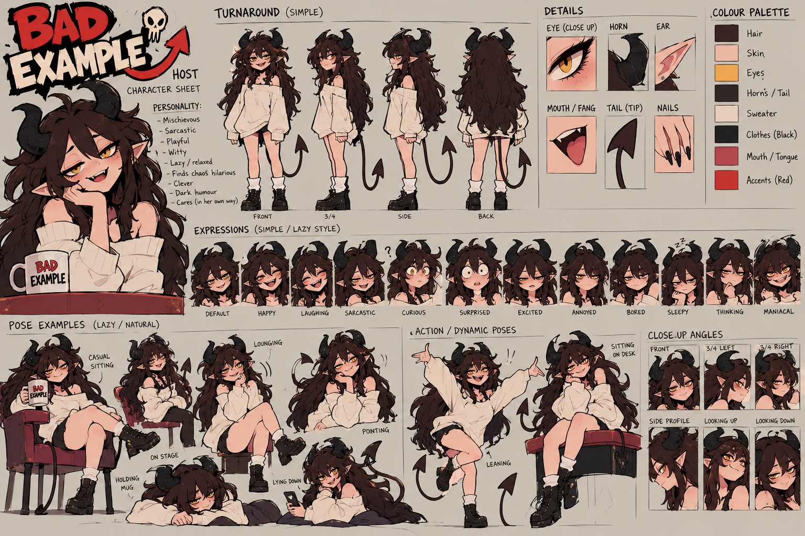
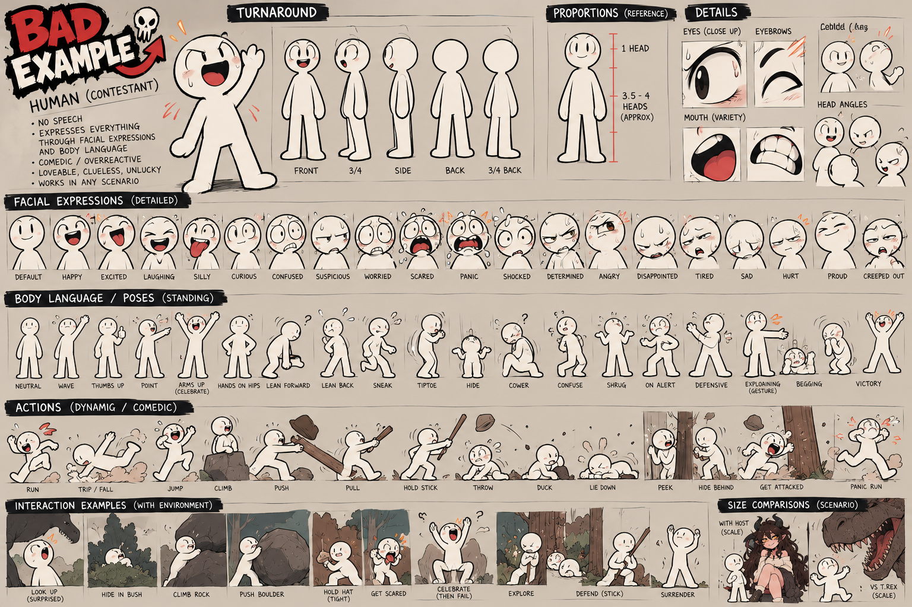

# Cast and continuity bible — Bad Example

Extracted from the six supplied reference sheets by direct visual inspection and OCR,
cross-checked against the written locks in `README_AGENT.md` and the pilot PDF.

**Precedence when sources disagree:** written brief > primary sheets > exploratory sheets.
The pack states this explicitly, and one real contradiction was found (see
[Accent](#contradiction-1--the-hosts-accent)).

---

## Demon host

### Design lock

| Feature | Specification |
|---|---|
| Build | Adult female demon, human proportions, ~7 heads tall |
| Skin | Pale warm peach (`#EBB59F`-ish), rosy blush at cheeks and shoulders |
| Eyes | Large, amber/gold (`#E8A33D`), dark upper lash line, half-lidded by default |
| Horns | Large, black, curving back and outward from the temples. **Ribbed/ridged texture.** Never straight, never symmetrical-forward |
| Ears | Long pointed elf ears, angled outward and slightly back |
| Hair | Very long, messy, dark warm brown-black (`#3A2320`). Heavy volume, over-the-shoulder fall, visible strand separation. **Never tidied per shot** |
| Tail | Long, thin, black, ends in a **spade/arrowhead tip** |
| Mouth | Fanged — visible upper fang on smirk; large pink tongue (`#C4707A`) |
| Nails | Long black pointed claws |
| Wardrobe | Oversized off-white/cream jumper (`#F2EAD9`), worn off one shoulder. Black shorts/skirt. Black lace-up boots with white socks |
| Linework | Clean 2D cartoon/anime-influenced, dark brown-black outlines |

### Colour palette (from the sheet's own swatches)

| Use | Colour |
|---|---|
| Hair | near-black warm brown |
| Skin | pale peach cream |
| Eyes | amber / gold |
| Horns / Tail | near-black |
| Sweater | off-white cream |
| Clothes | black |
| Mouth / Tongue | dusty rose pink |
| Accents | bright red |

### Acting states available on the sheet

12 expression heads: **DEFAULT, HAPPY, LAUGHING, SARCASTIC, CURIOUS, SURPRISED,
EXCITED, ANNOYED, BORED, SLEEPY, THINKING, MANIACAL**

Plus pose studies: casual sitting, lounging, on stage, holding mug, lying down,
pointing, leaning, sitting on desk. Close-up angles: front, 3/4 left, 3/4 right, side
profile, looking up, looking down. And a front/side/back/3-4 turnaround.

> **Pilot requirement** is "3 distinct host acting states". The sheet offers 12. Plenty
> of headroom — use SARCASTIC, BORED, and MANIACAL for the pilot's comedy beats.

### Personality (verbatim from the sheet)

Mischievous · Sarcastic · Playful · Witty · Lazy/relaxed · Finds chaos hilarious ·
Clever · Dark humour (in her way) · Cares (in her own way)

### Voice direction (written brief — authoritative)

> Warm, slightly low, soft, subtly sleepy and charismatic. **Neutral American accent.**
> Dry, sarcastic, mischievous; relaxed rather than hyperactive. Comedic timing uses
> half-lidded looks, slight smirks, long pauses and understated reactions.

---

## Silent human (contestant)

### Design lock

| Feature | Specification |
|---|---|
| Body | Pure white / near-white, **thick uniform black outline** |
| Head | Perfectly round, no hair, no ears, no nose |
| Face | Two dot-or-oval eyes, thick angled eyebrows, elastic mouth. **The face is the entire performance.** |
| Proportions | **3.5–4 heads tall** (explicitly annotated on the sheet) |
| Height | Same as the demon, or slightly shorter, for easier framing |
| Limbs | Simple tube limbs, no joints modelled, 4 fingers maximum (often mitten-like) |
| Speech | **NONE. Zero spoken words, ever.** Only nonverbal sounds. |
| Line weight | Consistent thick black — **must not vary between poses** |

### Expression library (20 states on sheet 02)

DEFAULT · HAPPY · EXCITED · LAUGHING · SILLY · CURIOUS · CONFUSED · SUSPICIOUS ·
WORRIED · SCARED · PANIC · SHOCKED · DETERMINED · ANGRY · DISAPPOINTED · TIRED · SAD ·
HURT · PROUD · CREEPED OUT

> **Pilot requirement** is "3 visibly different human expressions". The sheet offers 20.
> For the pilot arc use: EXCITED (scene 02) → CONFUSED (04) → SHOCKED (05) →
> PANIC (07) → DEAD-INSIDE TIRED (08).

### Pose and action library

**Standing (18):** NEUTRAL · WAVE · THUMBS UP · POINT · ARMS UP (CELEBRATE) · HANDS ON
HIPS · LEAN FORWARD · LEAN BACK · SNEAK · TIPTOE · HIDE · COWER · CONFUSE · SHRUG ·
ON ALERT · DEFENSIVE · EXPLAINING (GESTURE) · BEGGING · VICTORY

**Dynamic/comic (14):** RUN · TRIP/FALL · JUMP · CLIMB · PUSH · PULL · HOLD STICK ·
THROW · DUCK · LIE DOWN · PEEK · HIDE BEHIND · GET ATTACKED · PANIC RUN

**Environment interactions:** LOOK UP (surprised) · HIDE IN BUSH · CLIMB ROCK ·
PUSH BOULDER · HOLD HAT (TIGHT) · GET SCARED · CELEBRATE (THEN FAIL) · EXPLORE ·
DEFEND (STICK) · SURRENDER

### Wardrobe

Default is a plain white body ("underwear look"). Costumes are **detachable overlays**:

| Outfit | Used in |
|---|---|
| **Explorer** (safari hat + backpack) | **This pilot** |
| Modern casual (red jacket, black cap) | Modern Day scenario |
| Medieval, Roman, Survival, Scientist, Knight, Winter, Fantasy | Other scenarios |

> The brief is explicit: the hat and backpack **"must not become permanent anatomy."**
> They are overlays and must be removable per scene. The end frame (sheet 05) correctly
> shows him *without* the hat on his head — he is holding it, defeated.

---

## The core dynamic

From sheet 04, the repeating five-beat structure of every episode:

1. **Explaining the plan** — she explains what to do; he doesn't listen
2. **Sending him** — she sends him to a new time/place
3. **Immediate trouble** — he instantly makes a bad decision
4. **Her reaction** — she watches, unimpressed or amused
5. **Bringing him back** — she retrieves him, usually injured or traumatised

This is the show's engine, and the T. rex pilot follows it exactly. Any future episode
should too.

### Scenario catalogue (10 settings already designed)

Prehistoric (befriends a dinosaur) · Ancient Rome (thinks he's a gladiator) · Medieval
(potions he shouldn't make) · Plague Era (questionable medicine) · Pirate Age (causes
problems immediately) · Viking (starts a fight) · Fantasy World (touches the cursed
item) · Modern Day (still makes bad decisions) · Space/Alien (tries to communicate) ·
Underwater (forgets he can't breathe)

---

## Contradiction 1 — the host's accent

**The sheets say British. The written brief says American.**

| Source | Says |
|---|---|
| Sheet 03 (`VOICE & SOUND GUIDE`) | "Soft. Playful. warm sarcastic. **British** mischievous accent" |
| Sheet 03 (main text) | "Soft. Expressive warm and **British** exaggerated woice" |
| Sheet 04 (personality notes) | "Playful, sarcastic, chaotic" — accent not stated |
| **Written brief (README + PDF)** | "**neutral American** accent" |

The pack anticipates this exact conflict:

> Source sheets may contain conflicting accent labels; this written requirement
> overrides them. — PDF p.4

**Resolution: neutral American.** The sheets are the visual source of truth; the brief
is the audio source of truth. This is recorded so the conflict is not rediscovered
mid-production and guessed at.

## Contradiction 2 — host wardrobe

Sheet 03 and sheet 04 show the host in **black** clothing in several panels, whereas the
primary sheet (01) and sheet 05 show the **cream jumper**. The brief resolves it: the
cream jumper is the locked default; "casual dark bottoms/boots when visible" are
permitted. **The cream jumper is authoritative.**

## Contradiction 3 — human scale

Sheet 03 caption reads "≈2.5 heads", while sheet 02 annotates "3.5–4 HEADS (APPROX)".
Sheet 04 says "Same height as demon (or slightly shorter)".

**Resolution:** sheet 02 is the PRIMARY sheet, so **3.5–4 heads** wins. It is also the
proportion that matches the rendered keyframes in sheet 05. This matters directly: a
wrong head count is the fastest way to make the character look like a different
character.

---

## Keyframes (sheet 05)

**Start image:** warm stage. Marquee sign "BAD EXAMPLE" with skull motif, warm bulbs.
Host behind a red lectern with a horned-skull emblem, holding a "BAD EXAMPLE" mug,
gesturing to the human, who stands on a spotlit circular platform, arms up, delighted.
Audience silhouetted in the foreground.

**End image:** same stage. Sign now reads "SURVIVAL: **FAILED**" (red) and
"COMMON SENSE: **PENDING**" (yellow) with a skull. Host leans on the lectern, chin on
hand, smug and unimpressed. Human sits in the dust, bandaged, holding his explorer hat,
battered. A wooden sign behind reads "**T.REX: 2  HUMAN: 0**".

> Both images contain **embedded sample lettering**. The brief says treat it as
> "a reference, not finished text for export." Signage must be re-typeset in the app,
> not cropped from these images.

---

## Rigging assessment — the critical finding

All six sheets are **flat RGB composites with no alpha channel**. Every character pose
on them is a single flattened drawing, not separable layers.

**Consequence:** the pilot's requirement of "at least one actual animated human
movement, not a Ken Burns zoom" **cannot** be met by cropping these images. Layers must
be constructed.

However, costume overlays make this more tractable than it first appears. The
recommended approach for the human, in order of effort:

1. **Procedural rig from primitives.** The human is geometrically simple — a circle
   head, tube limbs, an ellipse body. Rebuilding him as vector shapes with named parts
   (head, torso, upper/lower arm, upper/lower leg, eyebrows, eyes, mouth) is entirely
   feasible and gives *real* rigged animation with correct line weight. The sheets then
   serve as the visual reference to match, and the 20 expressions become face-swap
   textures.
2. **Masked extraction** of specific poses from the sheets where procedural fidelity is
   insufficient, accepting manual cleanup of the outline.
3. **AI generation** with the sheet pinned as a reference — last resort, because
   OpenAI's own documentation warns these models "may occasionally struggle to maintain
   visual consistency for recurring characters." Drift is the specific failure the brief
   forbids.

The demon host is harder — detailed hair, horns and tail do not reduce to primitives as
cleanly. She is the better candidate for layered masking plus limited articulated
motion, and for the pilot her performance is largely facial (expressions are drawn as
discrete heads on the sheet, which helps).

**This is the highest-risk item in the whole test.** It is addressed first.